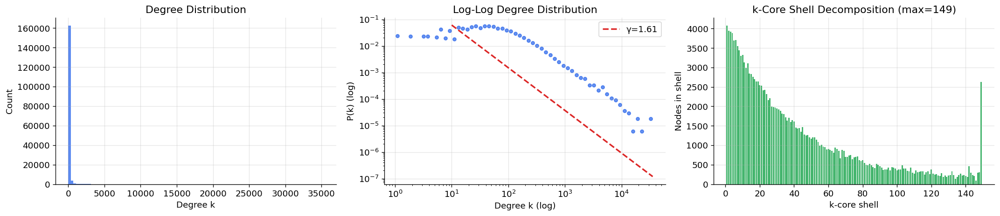
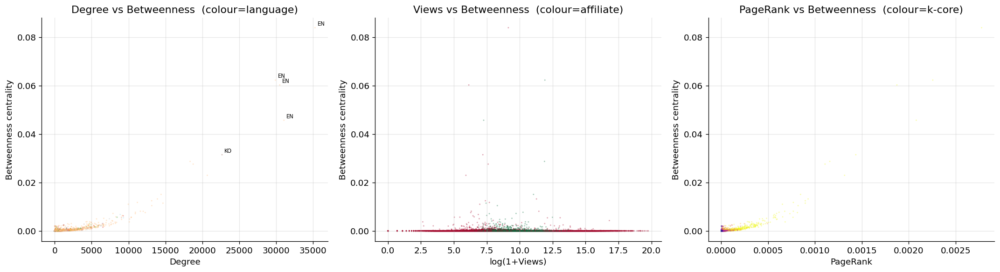
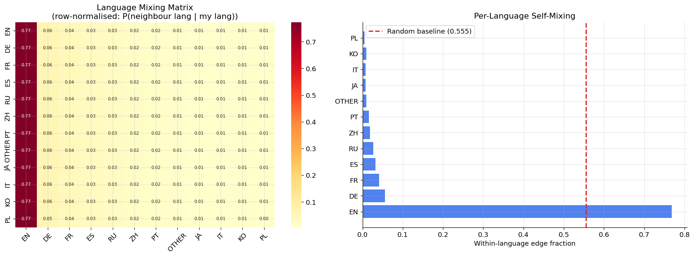
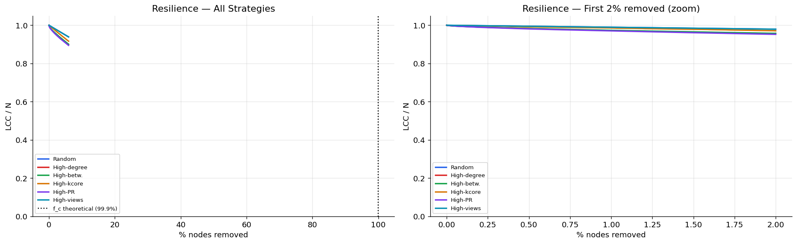
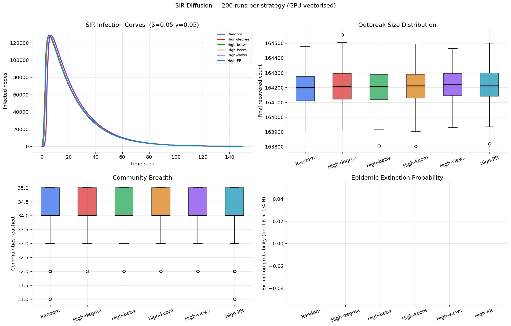
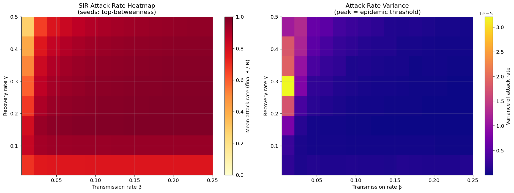

# Popularity vs Brokerage: Diffusion in the Twitch Gamers Social Network

**GPU-accelerated analysis of a 168K-node social graph: community structure, centrality, resilience, and SIR diffusion.**


## Overview

This project analyses the [SNAP Twitch Gamers](https://snap.stanford.edu/data/twitch_gamers.html) social network — **168,114 nodes and 6,797,557 edges** after extracting the largest connected component — to separate popularity from structural brokerage and to study how network structure shapes epidemic diffusion.

The notebook was developed for a GPU-heavy coursework project on a no-internet Kaggle kernel with an **NVIDIA RTX PRO 6000 Blackwell** (95 GB visible VRAM). It combines NetworkX, `nx-cugraph`, CuPy sparse linear algebra, and PyTorch for graph analytics and vectorised SIR simulation.

## Research questions

1. Are the most-connected / most-watched streamers the most structurally important?
2. How do language-community barriers shape epidemic spreading?
3. Where is the epidemic threshold, and does community structure shift it?

## Headline findings

- **Popularity is not brokerage.** The Pearson correlation between `log(1 + views)` and betweenness is **0.000**, while degree and PageRank correlate with betweenness at **0.757** and **0.809**. The most-watched accounts are low-degree and peripheral; the top-betweenness accounts are high-degree nodes in the maximum k-core.
- **Louvain communities do not follow language.** Modularity is **Q = 0.423**, but NMI against language labels is **0.001** and ARI is **-0.001**. Edge homophily is **0.5616** versus **0.5553** expected by chance (normalised homophily **0.0141**), so language mixing is close to random.
- **The network is extremely resilient.** The Molloy–Reed random-removal threshold is **f_c ≈ 0.9992**. After removing 1% of nodes, the largest connected component retains **97.0–99.0%** of its original size depending on the strategy.
- **Diffusion saturates regardless of seed strategy.** At β = γ = 0.05, all six seed sets reach approximately **97.7%** of nodes and **34 of 35** communities. The analytic HMF threshold is effectively zero, and the empirical variance peak sits at or below the lowest β in the sweep.
- **Affiliates are not more bridge-like.** Mean cross-community fraction is **0.352** for affiliates versus **0.353** for non-affiliates, and affiliate/non-affiliate SIR seeds produce the same final reach.

## Results

### Structural statistics

| Metric | Value |
|---|---:|
| Nodes | 168,114 |
| Edges | 6,797,557 |
| Density | 0.000481 |
| Average degree | 80.87 |
| Average clustering (5K sample) | 0.1597 |
| Erdős–Rényi clustering baseline | 0.000481 |
| Approximate diameter | 7 |
| Approximate average path length | 2.898 |
| Power-law exponent γ (k ≥ 10) | 1.610 |
| KS statistic for power-law fit | 0.1489 |
| Maximum k-core | 149 |
| Innermost k-core shell | 2,628 nodes |

The graph is small-world and dense, but the pure power-law fit is poor (KS = 0.149); γ should be treated as descriptive rather than definitive.

### Community and language structure

| Metric | Value |
|---|---:|
| Louvain communities | 35 |
| Modularity Q | 0.4228 |
| Largest community | 50,807 nodes |
| Median community size | 486 |
| NMI vs language labels | 0.001 |
| ARI vs language labels | -0.001 |
| Observed edge homophily | 0.5616 |
| Random-mixing homophily | 0.5553 |
| Normalised homophily | 0.0141 |

Language is not a useful proxy for the structural communities found by modularity in this network.

### Popularity vs brokerage

| Relationship | Pearson r |
|---|---:|
| `log(1 + views)` vs betweenness | 0.000 |
| Degree vs betweenness | 0.757 |
| PageRank vs betweenness | 0.809 |

The top 10 betweenness nodes are all in the maximum k-core (149) and 9 of them are English-language accounts. The top 10 views list is dominated by low-degree accounts (1–80 edges), whose audience is large but whose network position is peripheral.

### Resilience to node removal

| Removal strategy | LCC / N after 1% removed |
|---|---:|
| High-PageRank | 0.9704 |
| High-degree | 0.9728 |
| High-betweenness | 0.9735 |
| High-k-core | 0.9858 |
| Random | 0.9897 |
| High-views | 0.9897 |

The analytical random-removal threshold is **f_c ≈ 0.9992** (κ = ⟨k²⟩/⟨k⟩ = 1301.34). Targeted removal is slightly more damaging than random removal, but the network remains highly robust over the 6% removal window tested.

### SIR diffusion at β = γ = 0.05

| Seed strategy | Mean final R | Attack rate | Communities reached |
|---|---:|---:|---:|
| Random | 164,194 | 97.7% | 34.1 |
| High-degree | 164,215 | 97.7% | 34.2 |
| High-betweenness | 164,203 | 97.7% | 34.1 |
| High-k-core | 164,205 | 97.7% | 34.2 |
| High-views | 164,213 | 97.7% | 34.2 |
| High-PageRank | 164,217 | 97.7% | 34.2 |

The differences between strategies are tiny relative to the size of the network. At this transmission rate, the initial seed set does not materially change the final outbreak size.

### Epidemic threshold

| γ | β_c (HMF) | Empirical variance peak |
|---:|---:|---:|
| 0.01 | 0.0000 | 0.0050 |
| 0.02 | 0.0000 | 0.0050 |
| 0.05 | 0.0000 | 0.0050 |
| 0.10 | 0.0001 | 0.0050 |
| 0.15 | 0.0001 | 0.0050 |
| 0.20 | 0.0002 | 0.0050 |
| 0.30 | 0.0002 | 0.0050 |
| 0.50 | 0.0004 | 0.0225 |

Because the analytic thresholds are near zero and seven empirical peaks sit at the lowest β on the grid (0.005), the sweep establishes an upper bound on the threshold rather than a precise location.

## Selected figures

| Degree distribution and k-core structure | Popularity, connectivity, and brokerage |
|---|---|
|  |  |
| **Language mixing and homophily** | **Resilience to targeted removal** |
|  |  |
| **SIR diffusion by seed strategy** | **SIR parameter sweep** |
|  |  |

Additional figures in [`figures/`](figures) cover community sizes, centrality correlations, bridge nodes, affiliate centrality, the epidemic threshold, language-seeded SIR, and affiliate-seeded SIR.

## Approach

### 1. Data loading and graph construction

- Load the SNAP edge list and node features from CSV.
- Build an undirected NetworkX graph, extract the largest connected component, and re-index nodes to `0…N-1`.
- Attach six node attributes: `views`, `mature`, `life_time`, `dead_account`, `language`, and `affiliate`.
- Encode 21 language labels for community-alignment and language-seeded experiments.

### 2. GPU-accelerated graph analytics

| Analysis | Implementation |
|---|---|
| Louvain community detection | `nx-cugraph` GPU backend |
| Betweenness centrality | GPU approximation with `k = 500` source nodes |
| Closeness centrality | CPU sample of 5,000 nodes, projected back |
| PageRank | `nx-cugraph` GPU backend |
| Eigenvector centrality | `nx-cugraph` GPU backend |
| k-core decomposition | NetworkX CPU |

Exact betweenness would require an O(N²) allocation beyond the 95 GB device memory, so the approximate estimator is used and reported as such.

### 3. Resilience and percolation

Six removal strategies — random, high-degree, high-betweenness, high-k-core, high-PageRank, and high-views — each remove up to 10,000 nodes while tracking the largest connected component. The analytical random-removal threshold is derived from the Molloy–Reed criterion.

### 4. SIR diffusion

- Vectorised SIR over a CuPy sparse adjacency matrix.
- 200 Monte-Carlo runs × 150 steps per seed strategy.
- Six strategies, each seeded with the top 10 nodes under that metric.
- 120-combination β × γ sweep with 100 runs per combination.
- Language-seeded runs for the top 12 languages (10 seeds each).
- Affiliate vs non-affiliate runs using betweenness and views seeds.

## Repository structure

```text
.
├── diffusion-in-the-twitch-gamers-social-network.ipynb   # executed analysis (portfolio edition)
├── figures/
│   ├── fig_degree_kcore.png
│   ├── fig_communities.png
│   ├── fig_mixing_homophily.png
│   ├── fig_centrality_scatter.png
│   ├── fig_corr_lifetime.png
│   ├── fig_bridge.png
│   ├── fig_affiliate_centrality.png
│   ├── fig_resilience.png
│   ├── fig_sir_main.png
│   ├── fig_sweep_heatmap.png
│   ├── fig_threshold.png
│   ├── fig_lang_sir.png
│   └── fig_aff_sir.png
├── requirements.txt
└── README.md
```

## Running the notebook

```bash
pip install -r requirements.txt
jupyter lab diffusion-in-the-twitch-gamers-social-network.ipynb
```

The notebook auto-detects the dataset in `/kaggle/input/datasets/bipulprasad/twitch-gamers-snap-dataset` or the current directory. Place `large_twitch_edges.csv` and `large_twitch_features.csv` in one of those locations, or update `search_roots` in the data-loading cell.

A CUDA GPU is strongly recommended. The full run took approximately **6.1 hours** on the Kaggle GPU, dominated by the six-strategy resilience experiment (about 4h 14m). The notebook includes CPU fallbacks for some operations, but the full analysis will be much slower without a GPU.

## Notes and limitations

- **Betweenness is approximate** (`k = 500`), not exact. Closeness is computed on a 5,000-node sample.
- **The language barrier ratio was not implemented** in the executed run. The second panel of the language figure plots `final_R / language pool size`, which is dominated by language size; the per-language final outbreak sizes are the reliable comparison.
- **The power-law fit is weak** (KS = 0.149), so γ = 1.610 is descriptive rather than a confirmed scale-free exponent.
- **Single seed.** The results use one random seed; multi-seed confidence intervals would strengthen the negative findings about seed strategy and language effects.

## Tech stack

Python, NetworkX, `nx-cugraph`, CuPy, PyTorch, NumPy, pandas, scikit-learn, Matplotlib, Seaborn.

## Dataset and citation

- Dataset: [SNAP Twitch Gamers](https://snap.stanford.edu/data/twitch_gamers.html)
- Reference: Rozemberczki, B., & Sarkar, R. (2021). *Twitch Gamers: a Dataset for Evaluating Proximity Preserving and Structural Role-based Node Embeddings.* arXiv:2101.03091.

## Author

**Bipul Prasad** — [@bipulprasadjain007](https://github.com/bipulprasadjain007)

Coursework project, 2025/26.
